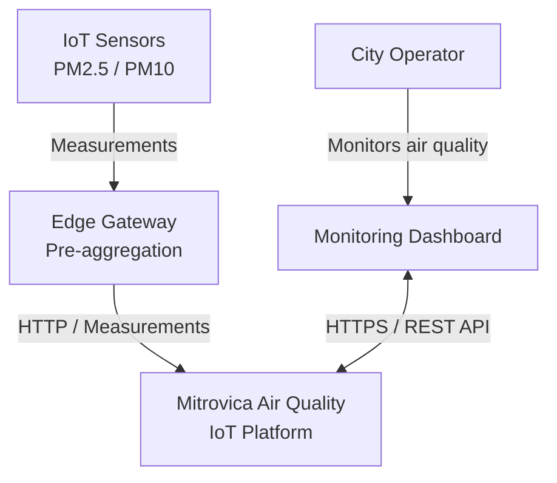
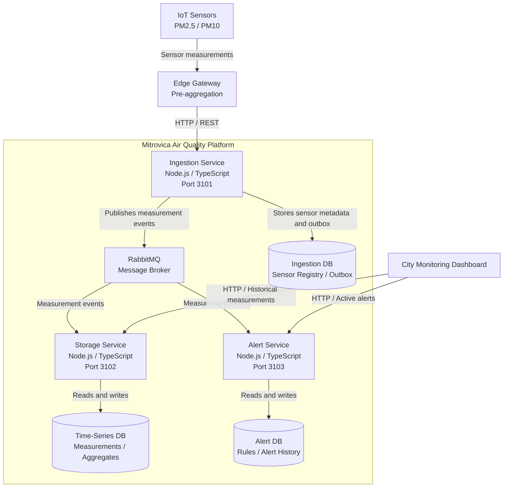

# System Architecture

## 1. Project Overview

Mitrovica Air Quality is an IoT-based platform designed to monitor air pollution levels across Mitrovica, Kosovo.

The platform collects PM2.5 and PM10 measurements from distributed IoT sensors, processes incoming measurements, stores historical data, and generates pollution alerts.

The architecture follows a microservices approach with independent data ownership and asynchronous communication.

## 2. Main System Requirements

The system is designed to support:

- 1,000 IoT sensors.
- One measurement every 5 seconds per sensor.
- 200 incoming messages per second.
- PM2.5 and PM10 measurements.
- Real-time pollution alerts.
- Raw data retention for 7 days.
- One-minute aggregate retention for 90 days.
- Edge-side pre-aggregation.

## 3. C4 Level 1 - System Context Diagram

The system interacts with three main external actors:

- **IoT Sensors:** Collect PM2.5 and PM10 measurements.
- **Edge Gateway:** Collects and optionally pre-aggregates measurements before forwarding them.
- **City Operator:** Uses the monitoring dashboard to observe air quality and receive pollution alerts.

## 4. C4 Level 2 - Container Diagram

The platform consists of three independent microservices. Each service is responsible for its own business logic and data.

## 5. Microservice Responsibilities and Data Ownership

### 5.1 Ingestion Service

**Port:** 3101

Responsibilities:

- Receives measurements from the Edge Gateway.
- Validates incoming sensor data.
- Manages sensor registration and metadata.
- Publishes measurement events through RabbitMQ.
- Uses the transactional outbox pattern to improve message delivery reliability.

**Data ownership:**

- Sensor registry.
- Sensor metadata.
- Outbox records.
- Ingestion idempotency records.

### 5.2 Storage Service

**Port:** 3102

Responsibilities:

- Consumes measurement events from RabbitMQ.
- Stores raw PM2.5 and PM10 measurements.
- Creates one-minute aggregates.
- Provides historical measurement queries.
- Applies data retention policies.

**Data ownership:**

- Raw sensor measurements.
- One-minute aggregated measurements.
- Time-series data and retention metadata.

**Planned database:** PostgreSQL with TimescaleDB.

### 5.3 Alert Service

**Port:** 3103

Responsibilities:

- Consumes measurement events from RabbitMQ.
- Evaluates pollution thresholds.
- Generates pollution alerts.
- Stores active alerts and alert history.
- Provides an API for retrieving alerts.

**Data ownership:**

- Alert rules.
- Active alerts.
- Alert history.
- Alert processing state.

## 6. Communication Patterns

The system uses synchronous and asynchronous communication.

### 6.1 Synchronous Communication - HTTP/REST

- Edge Gateway sends measurements to Ingestion Service.
- Dashboard requests historical measurements from Storage Service.
- Dashboard requests active alerts from Alert Service.

### 6.2 Asynchronous Communication - RabbitMQ

- Ingestion Service publishes measurement events.
- Storage Service consumes events for persistence and aggregation.
- Alert Service consumes events for threshold evaluation.

Both consumers process events